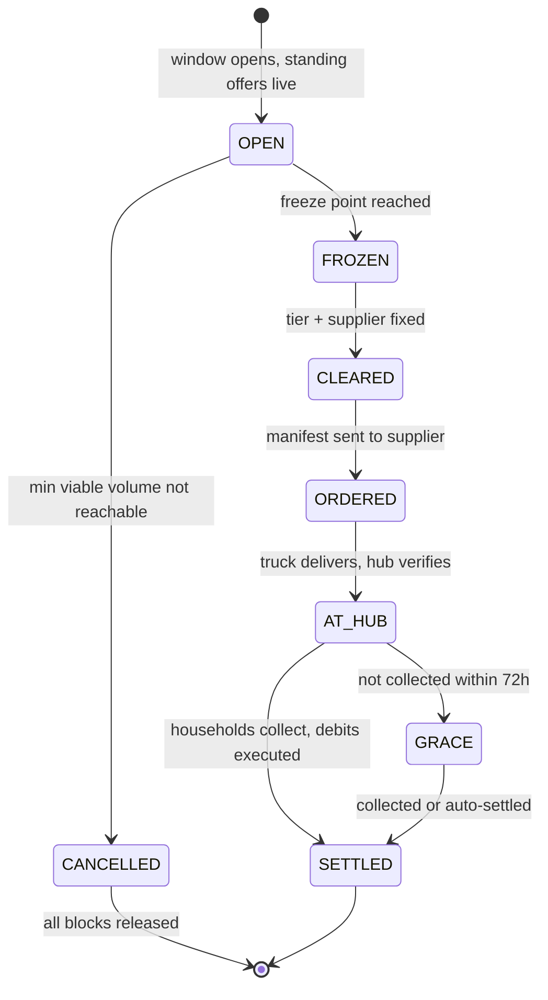
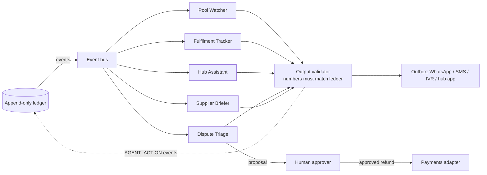
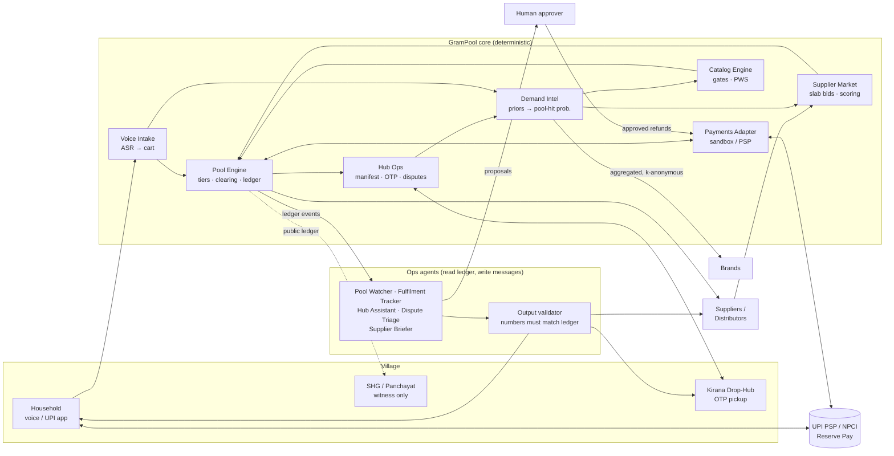

# GramPool

> **Pool the village. Keep your own money. Pay only when the goods are in your hand.**

*Working name. Solution for Problem Statement 5.2: "Villages buy everything in small lots with no bargaining power".*

---

## 0. TL;DR

- **The gap:** a village household buys ₹1,000–₹4,000 of staples and farm supplies a month in tiny lots, so it pays full retail. Distributors skip the village because nothing about its demand is recorded.
- **Our idea:** a *cluster* of 3–5 villages pools its monthly demand into one **pre-paid, pre-manifested truck drop**. Each household locks only its own money in its own UPI app. Money moves only when the household collects goods at a local kirana "drop hub".
- **What is new:**
  1. A **Never-Worse Guarantee**: the price a household commits to is, by construction, no higher than the verified local price.
  2. **Slab-bid supplier market**: suppliers bid price-by-volume schedules, not a single price, so the "volume discount" is real and auditable.
  3. A **Pool-Worthiness catalog engine** that decides *what not to pool*, e.g. the ₹2 sachet, where the kirana already wins.
  4. A **Kirana Make-Whole Rule** so the local shopkeeper is never worse off. Without it, he is the one actor who can kill the project.
  5. A demand layer whose forecast target is **"will this pool reach tier k?"**, not "how much will we sell?", because orders are pre-paid and we hold no stock.
  6. An **agentic ops layer** that tracks every pool from commitment to pickup and talks to households, hubs and suppliers in their language, with one hard rule: **agents never touch money or prices**.
  7. A **Village Demand Ledger**: aggregated, anonymised demand and price signals that finally make rural demand visible to brands and distributors.
- **Where the saving comes from:** mostly distributor drop and credit costs plus a pack-size premium, and only partly from kirana margin on volume he would otherwise have sold (Section 12). One real distributor quote is therefore the make-or-break piece of pilot evidence.
- **Honest finding:** with conservative assumptions, per-household savings are small (~₹60–₹140/month). The value proposition must therefore include **time and travel saved**, and the pool must clear a distributor's minimum drop. Section 12 shows the break-even adoption rates and where the saving actually comes from.

---

## 1. The problem in numbers

All figures below come from the research brief we studied (MoSPI HCES 2023-24, NSO 77th Round SAS, NAFIS 2021-22 and others). We checked the internal arithmetic. We have **not** re-verified each primary source. See the assumptions registry in Section 20.

| Fact | Number | Why it matters |
|---|---|---|
| Avg rural monthly spend per person (HCES 2023-24, excl. free transfers) | ₹4,122 | Baseline for the household budget |
| Household size (NAFIS 2021-22) | 4.3 | Monthly spend per household ≈ ₹17,725 |
| Shelf-stable staples + misc. goods per household | ₹3,578/month (~20%) | The poolable core |
| Conveyance per household | ₹1,346/month | Includes commuting, so it is **not** all shopping-trip cost |
| Farm outlay of reporting agri households (2018-19 nominal) | ₹3,739 crops, ₹3,018 livestock /month | Agri inputs are the highest-ticket pooling target |
| Avg distance of a village to the nearest 10k+ town | 15.4 km | The hidden "distance tax" |
| COD failure on rural parcels | 22%-50% | Why individual doorstep delivery fails |
| Kirana share of grocery | ~91% | The incumbent we must work *with* |

**Three structural reasons villages overpay**

1. **Small-lot penalty.** Small packs and loose weights carry high per-unit prices, though not always (see the sachet trap in Section 6).
2. **Distance tax.** A trip to town costs fare, a meal and half a day of work.
3. **Failed last mile.** Online deals don't reach rural PIN codes: surcharges, COD failures and non-serviceable areas.

---

## 2. Why earlier attempts lost money (and what we avoid)

| Player | What happened (as reported) | Lesson we apply |
|---|---|---|
| DealShare | Heavy discounting on thin-margin groceries, large losses, B2B arm closed | No customer-acquisition discounts. Savings come only from real supply-chain cost removed. |
| CityMall | ~₹450-500 baskets with zero delivery fee, large net loss | No single-household doorstep delivery. One drop per cluster. |
| ElasticRun | Low-margin commodity resale grew revenue and losses together | We never take inventory or resell. We are a clearing and intelligence layer. |
| DeHaat | Input retail alone doesn't cover rural last-mile cost | Bundle input pooling with output and advisory *later*. Not in v1. |
| FPOs / SHG federations | CEO capture, passive members, panchayat interference once cash appears | SHGs and panchayats are **witnesses, never cash custodians**. |

**Design rule:** *the venture never holds cash, never holds stock, never sets prices by hand.*

---

## 3. The solution in one view

GramPool has three **keys**, held by three different parties, so no single party can cheat:

| Key | Held by | Mechanism |
|---|---|---|
| 💰 **Money key** | The household's own bank | UPI Reserve Pay block, debited only at pickup |
| 📦 **Goods key** | A kirana drop hub | OTP-verified handover, weighed and graded on arrival |
| 👁 **Information key** | A public ledger, witnessed by SHG/panchayat | Every commitment, tier, bid and allocation is visible to all participants |

### What is new here (and why)

| # | Idea | Problem it solves | Where it comes from |
|---|---|---|---|
| 1 | **Never-Worse Guarantee**: the tier-1 (highest) price a household can be charged is ≤ the verified local benchmark price, or the SKU is not opened | Households fear "group buy" means paying more | Boundary: "each person commits only their own money" |
| 2 | **Slab-bid reverse auction**: suppliers submit price-by-volume schedules; one scoring formula is published | A single bid price can't reflect volume discounts that depend on pool size | Fixes a gap in the multi-attribute auction in the research brief |
| 3 | **Pool-Worthiness gates**: automated rules decide which SKUs enter the catalog | Group buying that beats the kirana on ₹2 sachets loses money | Sachet-trap and quality-elasticity evidence |
| 4 | **Kirana Make-Whole Rule**: hub fee is sized to cover displaced margin | The shopkeeper retaliates against a platform that takes his cash sales | Incumbent analysis (91% share, 5-10% margins) |
| 5 | **Pool-hit forecasting**: predict P(pool reaches slab k) | Demand has never been recorded and we hold no stock | Cold-start demand section |
| 6 | **Pickup no-show policy** | Pre-paid goods nobody collects is the rural RTO problem in a new place | Our addition |
| 7 | **Agentic ops layer with a hard money boundary**: five agents track pools and handle exceptions, but cannot call payments or edit prices | Low-literacy users and thin-margin operations need active follow-up, yet an LLM near money would break the "nobody can cheat" promise | Our addition |
| 8 | **Surplus waterfall**: all fees are published before bidding, suppliers bid net of fees, and the buyer's discount is what the slab leaves | Fees and discounts get argued about after the fact. Here the split is visible up front. | Our addition |
| 9 | **Village Demand Ledger**: aggregated, anonymised demand and price signals for brands and distributors | "Informal rural demand goes unrecorded" is a core reason villages are under-served | Problem statement: a village that can tell a supplier what it will buy next month |

---

## 4. How a pool works, end to end

1. **Open.** The system opens a *pool window* (default 7 days) for a cluster. Suppliers have already posted standing slab offers.
2. **Commit.** A household speaks its order in its own language (or uses the hub assistant). The app reads it back and shows a **cart**. The household approves **one** UPI Reserve Pay block for the cart's *ceiling* price.
3. **Watch.** A public tier meter shows funded volume and the current tier price. Only *funded* commitments count.
4. **Freeze.** At the freeze point (e.g. 24 h before close) withdrawals stop. The final tier and supplier are fixed.
5. **Clear.** Every buyer in the pool pays the **same final tier price**. The surplus between ceiling and final price is released at once.
6. **Ship.** One manifest, one truck, one drop at the hub.
7. **Collect.** The household shows an OTP. The hub verifies weight and grade, and the debit executes for exactly what was collected.
8. **Learn.** Unmet requests, failed pools and no-shows go back into the demand model.



---

## 5. Market design: fair and manipulation-resistant

### Rules

| Rule | What it does | Attack it stops |
|---|---|---|
| **R1 Funded-commitment gate** | A unit counts toward the tier meter only if a UPI block (or OTP-verified hub deposit) backs it | Fake demand that unlocks a discount |
| **R2 Uniform clearing price** | Everyone in a completed pool pays the same final tier price, whenever they joined | Holding out until the last minute |
| **R3 Freeze point** | Withdrawals are allowed until freeze, then funds are locked. Before freeze, any withdrawal re-prices the public meter immediately | Commit-then-withdraw to strand buyers |
| **R4 Never-worse ceiling** | The block is placed at the tier-1 price, which must be ≤ the verified local benchmark | Households paying more than local retail |
| **R5 Slab bids** | Suppliers post price per volume slab. The winner is picked by a published score | Bids that ignore pool size |
| **R6 Grade tiers** | High-quality-variance goods are split into certified grades. No mixing in a pool | Quality dumping |
| **R7 Pro-rata rationing** | If a supplier's cap is below demand, allocation is proportional and visible. Anyone whose fill drops under their self-set minimum gets a full release | Favouritism in scarcity |
| **R8 Public bid reveal** | After close, anonymised bids and scoring weights are published | "Why did this supplier win?" disputes |

### Supplier scoring

Each supplier *s* posts, for each volume slab *k*: price `p_sk`, a certified quality tier `q_s`, and a delivery lead time `l_s` (≤ max window `L`). The score at the *cleared* volume is:

```
U_s = w1 · q_s^a  +  w2 · (L − l_s)^b  −  p_s(k*)
subject to  q_s ≥ q_min,  l_s ≤ L,   0 < a, b ≤ 1
```

where `k*` is the slab the pool actually reached. Weights `w1`, `w2` and exponents are published before the window opens. The weights are expressed in rupees, so quality and speed are priced in the same unit as the bid.

### Worked example (illustrative numbers)

*SKU: 5 L edible-oil tin. Verified village benchmark: ₹880.*

| Slab | Funded volume | Supplier A price |
|---|---|---|
| 1 | 0-39 tins | ₹850 |
| 2 | 40-99 tins | ₹820 |
| 3 | 100+ tins | ₹795 |

- Every household blocks **₹850** per tin (tier-1 ceiling, already below ₹880, so R4 is met).
- The pool closes with **110 funded tins**, so the clearing price is **₹795** for all 110.
- Each buyer is debited ₹795 at pickup, and ₹55 per tin is released immediately.
- Saving vs benchmark: ₹85 per tin (9.7%).
- A shill who committed 20 tins and withdrew *before* freeze only lowered the public meter. The remaining buyers saw it and could react. After freeze, nobody can withdraw.

---

## 6. Catalog engine: deciding what to pool

Pooling only helps where the small-lot penalty is real. A SKU enters the catalog only if it passes **all gates**, and is then ranked by score.

### Gates

| Gate | Rule | Example |
|---|---|---|
| **G1 Never-worse** | Tier-1 price ≤ benchmark − ε, benchmarked on the pack size households actually buy | Edible oil: pass |
| **G2 Not a loss-leader** | If the small format is *cheaper per unit* than the bulk (trial sachets), drop it | ₹1.50 shampoo sachet: **excluded** |
| **G3 Shelf-stable** | Shelf life ≥ 90 days, no cold chain | Milk, vegetables: excluded |
| **G4 Quality dispersion** | Quality elasticity *b* < 0.1: one grade. 0.1 ≤ *b* < 0.3: certified tiers. *b* ≥ 0.3: out of v1 | Sugar *b* ≈ 0.003, mustard oil ≈ 0.004: one grade. Rice ≈ 0.19: tiers. Garments ≈ 0.48: excluded from v1 |
| **G5 Price-controlled goods** | If the retail price is government-fixed, there is no discount to share | Subsidised urea: pool for availability only (confirm in the field) |

The *b* thresholds are our proposal, derived from the quality-expenditure elasticities in Almås & Kjelsrud (2017). They are a starting rule, not an established standard.

### Score

```
PWS(sku) = E[monthly cluster volume] × (benchmark − slab price − hub fee − platform fee) × (1 − dispersion penalty)
```

### Day-1 catalog (≈20 SKUs, to be confirmed by the field survey)

Edible oil (tins/pouches), atta, non-PDS rice, toor/chana dal, sugar, salt, turmeric and chilli powder, detergent powder and bars, bath soap, tea, and (in season) seeds, pesticides, micronutrients and cattle feed.

---

## 7. Payments: non-custodial by design

**Flow**

1. The buyer approves one **UPI Reserve Pay** (single-block, multiple-debit) mandate for the cart ceiling.
2. Funds stay in the buyer's bank account.
3. At pickup, the supplier-side merchant debits the **exact** final amount. The unused part of the block is released.

**Constraints we design around**

| Constraint | Status | Our response |
|---|---|---|
| NPCI circular OC-228 (Oct 2025) renamed SBMD to "UPI Reserve Pay" | Confirmed to exist | n/a |
| Maximum mandate ≈ ₹10,000; validity ≈ 90 days (per PSP documentation) | Reported by PSPs, **verify** | Our monthly basket averages ~₹1,000-₹4,850, so it fits. A 7+7-day cycle is well inside 90 days. |
| One active block per mobile number per merchant | **Verify** with a PSP | The **cart is the unit**: one editable mandate per household per window, not one block per SKU |
| Merchant category codes eligible today are limited | **Verify** | Start with grocery-type categories. Agri inputs need a PSP check. |
| Revocation controls in the UPI app | Reported | Freeze point + a commit lock, so a block can't be revoked in transit |
| Who is the merchant? | **Our decision** | v1: **suppliers are the merchants.** GramPool is a technology service provider paid by supplier-side invoice. It never touches buyer funds. If GramPool ever becomes merchant-of-record, payment-aggregator regulation applies. |

**For the demo:** a clearly disclosed *sandbox PSP simulator* replays block, modify, debit and release events.

**Unbanked and shared-phone households:** a household deposits ceiling cash at the hub and receives an OTP receipt by SMS on a feature phone. This introduces custody risk at the hub, so it is **capped** (e.g. ₹1,500 per household per window), logged in an auditable sub-ledger, and treated as a pilot-only path.

**Pickup no-show policy (proposed):** the mandate includes consent to settle automatically 72 hours after hub arrival. The goods stay at the hub for a further 7 days, the kirana is paid the handling fee regardless, and repeat no-shows reduce a household's join priority. *This needs a PSP and legal check.*

---

## 8. Demand intelligence: forecasting where no data exists

### The reframe

Orders are **pre-paid**, so we don't forecast stock. We forecast three things:

1. Which SKUs are worth **opening** in a cluster.
2. How large a **standing offer** a supplier can safely make.
3. The probability **P(pool reaches slab k by window close)**.

### Pipeline

| Stage | Input | Method | Output |
|---|---|---|---|
| 1. Day-0 prior | HCES state-wise rural spend fractiles, household count, agri share, distance to town | Budget-share disaggregation. Engel-curve shape (cereal share falls with income, misc. non-food rises) calibrated on HCES unit-level data | Expected monthly basket per household by category |
| 2. Adoption and capture | Cluster attributes, field survey | Beta priors for adoption and capture rate | Expected pooled GMV with uncertainty |
| 3. Online update | Completed pools, failed pools, voice requests | Gamma-Poisson / negative-binomial per SKU-cluster. Each cycle updates the rate. | Posterior demand per SKU |
| 4. Uncensoring | Near-miss pools, unmet voice requests | Count unmet requests as demand with a discount weight | Removes the "failed pool = zero demand" bias |
| 5. Pool-hit probability | Posterior + slab thresholds | P(Y ≥ q_k) from the posterior | Tells suppliers where to place slabs |
| 6. Optional (≥ 26 cycles) | Mature history | Time-series foundation model baseline and hierarchical reconciliation | Only once enough history exists |

**Why not a foundation model on Day 0:** it needs history. At one pool every two weeks, a village produces roughly 26 points a year, so Stage 1-5 carries the project at first.

**Honest note on the source paper:** *Rags and Riches* (Almås & Kjelsrud) was estimated on NSS data from 1993-2012 and publishes only two of its ~85 parameters. We use it for **shape** (non-homothetic budget shares, quality elasticities, the unit-value method), not for plug-in 2026 coefficients.

### Evaluation

- **Pinball loss** and **P90 coverage** for demand quantiles.
- **Brier score and calibration plot** for pool-hit probabilities (the key metric).
- **WAPE and bias** against a naive moving average.
- Backtests must use **held-out pilot data**. Synthetic data generated from our own priors would be circular, so we label it as a unit test only.

---

## 9. Voice intake

- A household sends a **WhatsApp voice note** or uses **IVR** or the hub assistant, in its own language, with code-mixed phrases ("teen kilo chana dal").
- ASR via open Indic models (e.g. AI4Bharat IndicConformer) or Bhashini APIs.
- **Key simplification:** our catalog has only ~20 SKUs, so ASR output is matched against a **closed SKU lexicon** by fuzzy matching and quantity parsing. This is much easier than open-vocabulary transcription.
- The system always **reads the cart back** in voice and text before any UPI block is requested.
- Vendor-reported error rates on code-mixed speech are not our measurements, so we evaluate on our own recorded test set.
- **Privacy:** voice notes are personal data under India's DPDP Act 2023. We collect explicit consent, store transcripts rather than audio where possible, and delete audio after confirmation.

---

## 10. Tracking and ops agents

**Principle: deterministic core, agentic edge.** The pool engine, pricing, clearing, payments and refunds are fixed rules. Agents read ledger events and write messages, tickets and *proposals*. They cannot call the payments adapter or change a price, so the "visible to everyone, nobody can cheat" promise holds even if an LLM misbehaves.

### 10.1 What gets tracked

Every pool has one append-only timeline:

`POOL_OPENED → OFFER_POSTED → COMMITMENT_FUNDED / WITHDRAWN → FROZEN → CLEARED → ORDER_PLACED → SUPPLIER_CONFIRMED → DISPATCHED → ARRIVED_AT_HUB → WEIGHED_GRADED → PICKUP_OTP_VERIFIED → DEBITED / RELEASED → NOSHOW_GRACE → DISPUTE_OPENED / RESOLVED`

Physical movement is confirmed by **hub scans and supplier confirmations**, not GPS, because we run no fleet.

Households see a five-step tracker by voice, SMS or app: *Joined → Price fixed → Dispatched → At hub → Collected.*

After settlement each household gets a **price receipt**: the ceiling it blocked, the final price, its saving against the benchmark, the winning supplier and the slab reached. It can be read aloud on request and printed at the hub.

### 10.2 The five agents

| Agent | Triggered by | Reads | Writes | Rules vs LLM |
|---|---|---|---|---|
| **Pool Watcher** | Timer while a window is open | Tier meter, pool-hit probability, cluster roster | Nudges in the household's language, a near-miss log | Rules choose who and when (caps, quiet hours, opt-outs). The LLM only phrases the message. |
| **Fulfilment Tracker** | `CLEARED`, supplier SLA timers | Order, manifest, supplier confirmations | Chase messages, delay alerts, ETA updates. Escalates to ops after two missed SLAs. | Rules for timing and escalation. The LLM drafts wording. |
| **Hub Assistant** | `ARRIVED_AT_HUB` | Manifest, pickup list | A step-by-step checklist for weighing, grading and OTP pickup. Reminders at 24, 48 and 72 hours. | Rules. The LLM handles voice phrasing and answers the kirana's questions from a fixed script. |
| **Dispute Triage** | `DISPUTE_OPENED` | Hub weight record, photo, grade spec, supplier history | A category (short weight, wrong grade, damaged, not received) and a proposed outcome from a published rulebook | The LLM classifies and the rulebook decides. **A person approves any refund.** |
| **Supplier Briefer** | Before each window | Pool-hit forecasts, past pool results | A one-page brief with expected volume (P50 and P90) per SKU, so suppliers can post standing slab offers | Numbers are copied from `demand-intel`. The LLM only formats. |



### 10.3 Guardrails (non-negotiable)

1. **No payments or pricing tools.** Agents hold a read-only ledger tool, an outbox, a ticket tool and a "propose action" tool, nothing else.
2. **Every agent action is logged.** It is written back to the ledger as an `AGENT_ACTION` event, as visible as any other event.
3. **Numbers are injected, never generated.** An output validator rejects any message containing a number that is not in the ledger fields the agent was given.
4. **Free text is data, never instructions.** Supplier messages, household text and voice transcripts can't change an agent's behaviour (prompt-injection defence).
5. **Rate limits, quiet hours and an opt-out** for every household.
6. **Humans approve anything that moves money or penalises a household** (refunds, no-show priority).
7. **Graceful degradation.** If the LLM is unavailable, templated messages go out and the pool still runs.

### 10.4 How we will judge the agents

| Metric | Target |
|---|---|
| Message number-match rate (validator passes) | 100%. A failure blocks the message. |
| Nudge conversion: share of nudged households who fund a commitment, versus a randomised control group | Positive and measurable in the pilot |
| Time from supplier chase to confirmation | Falling cycle over cycle |
| Dispute classification accuracy against a hand-labelled set | Reported honestly, with a confusion matrix |
| Median time to resolve a dispute | Falling cycle over cycle |

**Honest scope:** agents earn their place in follow-up and exceptions for low-literacy users and thin-margin operations. We make no claim that an LLM improves pricing or clearing. Those are deliberately rules.

---

## 11. Actors and incentives

| Actor | Fear | What GramPool gives | Condition for them to say yes |
|---|---|---|---|
| **Households** | Paying more, losing money, not being served | Never-worse price, no travel, no money handed to anyone | Net saving beats their travel-indifference threshold (field Q6) |
| **Village micro-businesses** (tea stalls, tailors, small eateries) | Input cost swings, stock-outs | Recurring bulk supplies (oil tins, flour, cartons) at pooled prices | Net saving on large, repeating baskets (field Q1) |
| **Kirana** | Losing cash-paying staple sales | Hub fee, footfall, right to bid as a local supplier, perishables and udhaar stay with him | **Make-Whole Rule** (below) |
| **Distributors / brands** | Bad debt, tiny drops, wasted beats | Pre-paid, pre-manifested single drop; verified delivery; recovered scheme volume | Drop size ≥ their minimum (≈ ₹2.5 lakh in the brief) |
| **SHGs / panchayats** | Being bypassed | A defined role as outreach and quality *witness* | Never custody of cash |
| **Online sellers** | COD failures, ODA fees | One prepaid master carton to a hub | Cluster volume (later phase) |

### Kirana Make-Whole Rule

```
Net_kirana  =  f · G_pool  +  footfall_gain  −  m · D

f   = hub handling fee (base 3%)
G   = pooled GMV through his hub
m   = his retail margin on staples (5-10%)
D   = volume he would otherwise have sold = s · G_pool
s   = share of pooled volume that would have gone to *him* (rest was town-trip leakage)
```

If `s · m > f` (for example s = 0.5, m = 7% gives 3.5% > 3%), the hub fee is topped up to cover the gap, to a ceiling of 5% of pooled GMV. The top-up is paid out of supplier receipts under a fee schedule published **before bidding** (see the surplus waterfall in Section 12), so it lowers the discount buyers see by about ₹16 per ₹795 tin for each extra 2 percentage points. That is the price of keeping the kirana whole. If `s · m` exceeds the 5% ceiling, the rule can't make him whole on its own, and we fall back to keeping his best-selling SKUs out of the pool or having him bid as the local supplier. **`s` is unknown until we measure it in the field**, and a small calculator for it is planned for the pilot phase.

---

## 12. Unit economics (conservative first)

The research brief's illustrative model assumes a participating household routes its **entire** aggregable basket (₹4,850/month) through the pool and a 15% gross supply-chain saving. We treat that as the **upper bound** and show three scenarios for a **1,000-household cluster at 25% adoption (250 households)**:

| | Conservative | Base | Paper-optimistic |
|---|---|---|---|
| Capture (share of ₹4,850 basket bought via pool) | 20% | 35% | 100% |
| Pooled basket per household | ₹970 | ₹1,698 | ₹4,850 |
| Buyer saving rate | 6% | 8% | 10% |
| Monthly pooled GMV | ₹2.43 L | ₹4.24 L | ₹12.1 L |
| Fortnightly truck manifest | ₹1.21 L | ₹2.12 L | ₹6.06 L |
| **Saving per household / month** | **₹58** | **₹136** | **₹485** |
| Hub income (3%) / month | ₹7,275 | ₹12,731 | ₹36,375 |
| Platform fee (2%) / month | ₹4,850 | ₹8,488 | ₹24,250 |

**Break-even adoption** to reach a ₹2.5 lakh fortnightly drop, for a 1,000-household cluster:

| Scenario | Break-even adoption |
|---|---|
| Conservative | ≈ 52% |
| Base | ≈ 30% |
| Paper-optimistic | ≈ 10% |

**What this tells us**

1. Under conservative assumptions a single 1,000-household cluster **does not** clear the distributor's minimum drop. We need larger clusters, a monthly (not fortnightly) drop, or a higher-ticket season (agri inputs).
2. Per-household grocery savings (₹58-₹136) are **below** typical travel-indifference thresholds (₹100-₹500). The pitch must stress **time and fare saved**, and agri inputs, where the basket and the margin are larger.
3. Platform revenue per cluster is small (₹5-8K/month in conservative/base). The business needs **many clusters** and a second revenue line (brand-discovery fees from regional FMCG brands). That is why v1 stays asset-light, with no fleet and no inventory.
4. The distributor's side improves clearly because the drop is pre-paid and pre-manifested. We claim a drop-cost reduction to **roughly 1-2% of invoice** (not "near zero"), and we measure it in the pilot.

### Where the saving actually comes from (illustrative price stack)

*Example: one 5 L edible-oil tin, village benchmark ₹880, final tier-3 price ₹795. Every figure is an illustrative assumption to be replaced by pilot quotes.*

| Source | ₹ per tin | Basis |
|---|---|---|
| Kirana retail margin removed | +62 | 7% of ₹880 |
| Hub handling fee | −24 | 3% of ₹795 |
| Distributor drop and beat cost falls from 6% to 1.5% of the ₹818 invoice | +37 | The research brief puts small-drop delivery cost at 4-10% of invoice |
| Credit and collection cost removed | +12 | 1.5% of ₹818. The brief reports 25-45 day credit cycles. |
| Pack-size premium removed (1 L pouches → 5 L tin) | +16 | Assumption |
| Platform fee | −16 | 2% of ₹795 |
| **Total saving in the system** | **≈ +87** | |
| Buyer takes (₹880 − ₹795) | 85 | |
| Supplier keeps | ≈ 2 | |

At tier 1 (₹850) the fees change slightly, and the split becomes: system saving ≈ ₹84, buyer takes ₹30, supplier keeps ≈ ₹54. **The slab schedule is how the surplus is shared.** At low volume the supplier keeps most of it. At high volume the buyers get nearly all of it, and the supplier is paid back in volume, prepaid certainty and a faster cash cycle.

**What the stack tells us**

1. About ₹49 of the net ₹87 (56%) is **distributor-side cost** (drop and credit). So one real distributor quote is the make-or-break pilot evidence.
2. **Sensitivity:** every 1 percentage point less drop-cost saving removes about ₹8 per tin (≈ 0.9% of the price).
3. The kirana line is the other ₹38 (₹62 of margin removed, ₹24 paid back as hub fee). That is a real loss to him **only on volume he would otherwise have sold** (`s` in the Make-Whole Rule). Much pooled volume is town-trip leakage he never captured, so we must measure `s` in the field before promising he is made whole.

### Surplus waterfall (who gets what, in what order)

1. **Publish the fee schedule before bids open:** platform fee 2%, hub fee 3% base and up to 5% where the Make-Whole Rule applies.
2. **Suppliers bid slab prices knowing they are paid net of these fees.**
3. **The household sees the bid price** with every fee already inside it.
4. **The buyer's saving is whatever the slab leaves after fees** and it grows with volume.

Because the schedule is fixed in advance, nobody can renegotiate the split after the pool has closed.

---

## 13. Market, go-to-market and jobs

### 13.1 Context and who we serve first

Context from the research brief (not independently verified): 640,867 villages in the 2011 Census, 90.9 lakh SHGs, and 7.71 crore unincorporated non-farm establishments, of which 86.5% are run solely by working owners. We don't turn this into a headline market size, because what we can serve depends on adoption and capture, which are unknown until the pilot. The unit we count is the **cluster**.

| Segment | Why we think they matter | Evidence we need |
|---|---|---|
| Farmers | Highest-ticket, seasonal baskets (seeds, pesticides, feed) with 10-20% input margins | Field Q1, Q2 |
| Village micro-businesses | Repeat bulk buyers of the same SKUs (oil tins, flour, cartons), so larger and steadier baskets than households | Field Q1: include tea stalls, tailors and small eateries in the 20-30 household sample |
| Households | The widest base, but small savings per household (Section 12) | Field Q1, Q6 |

**Hypothesis:** farmers and micro-businesses are the faster route to a distributor's minimum drop, with households joining once the hub is trusted.

### 13.2 Go-to-market sequence

| Phase | Scope | Exit test |
|---|---|---|
| 1. Pilot | One cluster of 3-4 villages, ~20 SKUs, 1-2 hubs, one distributor letter of intent | Cluster clears a real pooled order and a distributor confirms the slab price |
| 2. Densify | 5-10 clusters in the same block sharing one distributor and one local helper network | Drop cost and support cost per cluster fall |
| 3. Widen | Agri-input seasons and micro-business baskets. Start brand-discovery and Village Demand Ledger sales. | A paying brand or distributor |
| 4. Expand | Block to district, a second distributor per category | Repeatable playbook |

**Wedge categories:** edible oil, atta and non-PDS rice, dal, sugar and salt, detergent. They are homogeneous, shelf-stable, high-turn and pass the catalog gates.

### 13.3 Revenue lines

| Line | Who pays | Size | Status |
|---|---|---|---|
| Supplier-side platform fee | Suppliers and distributors | 2% of pooled GMV (the brief suggests 1.5-2.5%) | Core, tested in the pilot |
| Brand-discovery and trial fees | Regional and challenger FMCG brands | The brief notes these brands already give up 10-25% retail margin for shelf space. No price set. | Hypothesis |
| **Village Demand Ledger** | Brands and distributors | Aggregated, anonymised demand and price signals, shared only where a cell has at least 10 households | Hypothesis. Needs a paying pilot customer. |

### 13.4 How many clusters do we need?

```
Break-even clusters  N* = F / (r − c)

F = fixed monthly cost of the platform and support team
r = platform revenue per cluster per month
c = local cost per cluster per month (e.g. a part-time village helper stipend)
```

*Placeholder inputs, to be replaced with real costs:* F = ₹1.5 lakh/month, c = ₹3,000/month.

| Scenario (Section 12) | r (₹/month) | N* |
|---|---|---|
| Conservative | 4,850 | ≈ 81 |
| Base | 8,488 | ≈ 27 |
| Paper-optimistic | 24,250 | ≈ 7 |

This is why we stay asset-light, and why brand-discovery and Village Demand Ledger revenue matter. Grocery fees alone need many clusters.

### 13.5 Jobs and livelihoods (per cluster, base case)

| Role | Count | Income effect |
|---|---|---|
| Hub kiranas | 3-5 | Hub fees total ≈ ₹12.7K/month, or ≈ ₹2.5-4.2K per hub, **before** any displaced margin |
| Village helper ("Gram Saathi"), part-time | 1-2 | Assumed stipend of ₹3,000/month paid from the platform fee. Helps with onboarding, carts and verification. Hypothesis. |
| SHG members as quality and ledger witnesses | A few | Unpaid in v1. Role is trust, not income. |
| Distributor drop staff | Existing | Fewer, larger drops. We don't claim new jobs here. |

We are not claiming a large workforce. The model supports **local part-time roles and supplementary hub income**.

---

## 14. Compliance and data protection

We have **not** verified any of these. Each needs a check with a chartered accountant, a lawyer or the payment partner before a real pilot.

| Area | Open question |
|---|---|
| Payments | Is the supplier the merchant? If GramPool collects money, payment-aggregator rules apply. |
| GST | Who invoices households? How are GST and the hub and platform fees treated? |
| Food safety | Does a hub that stores packaged food need a registration or licence? |
| Legal metrology | Weighing at the hub on verified scales, and no repacking at hubs |
| Agri-inputs | Seeds, pesticides and fertilisers need licensed sellers. Only licensed suppliers sell, and the hub only hands over. |
| Price-controlled goods | Subsidised fertilisers have government-fixed retail prices. No discount to share. |
| Data protection (DPDP Act 2023) | Explicit consent for voice and purchase data, minimal retention, a grievance contact. The Village Demand Ledger is exported only in aggregate. |
| Consumer grievance | A visible dispute path with a human decision (Section 10) |

---

## 15. System architecture



### Modules

| Module | Responsibility | Key interface |
|---|---|---|
| `voice-intake` | Audio → text → SKU + quantity → cart, with voice read-back | `POST /carts` |
| `pool-engine` | Pool state machine, funded-commitment gate, tier meter, uniform clearing, pro-rata rationing, public ledger | `POST /pools/{id}/commitments`, `GET /pools/{id}/ledger` |
| `supplier-market` | Standing slab offers, scoring, publish results | `POST /pools/{id}/offers` |
| `catalog-engine` | Gates G1-G5, PWS ranking, benchmark prices | `GET /catalog?cluster=` |
| `payments-adapter` | Interface with a sandbox implementation (real PSP later) | `block()`, `modify()`, `debit()`, `release()` |
| `demand-intel` | Day-0 priors, Bayesian updates, pool-hit probability, k-anonymous demand export (Village Demand Ledger) | `GET /forecast/pool-hit?sku=&cluster=`, `GET /insights/demand?cluster=&k=10` |
| `hub-ops` | Manifest, weighing and grading, OTP pickup, disputes, no-show handling | `POST /hub/receipts` |
| `ops-agents` | Tracking timeline, nudges, supplier chasing, hub guidance, dispute triage and supplier briefs, all behind an output validator | Consumes ledger events. Emits `AGENT_ACTION` events and outbox messages. |

### Repository layout

```
grampool/
├── README.md
├── docs/
│   ├── architecture.md        # module detail and data flow
│   ├── market-design.md       # rules R1-R8, auction, worked examples
│   ├── payments.md            # Reserve Pay flow, constraints, sandbox plan
│   ├── economics.md           # scenarios, break-even, Kirana Make-Whole
│   ├── demand-model.md        # priors, updates, evaluation
│   ├── field-playbook.md      # six field questions and decisions each unlocks
│   ├── ops-agents.md          # agents, guardrails, event timeline
│   ├── go-to-market.md        # phases, revenue lines, break-even clusters, jobs
│   └── compliance.md          # open legal and regulatory checks
├── services/
│   ├── voice-intake/
│   ├── pool-engine/
│   ├── supplier-market/
│   ├── catalog-engine/
│   ├── payments-adapter/
│   │   └── sandbox/           # disclosed PSP simulator
│   ├── demand-intel/
│   ├── hub-ops/
│   └── ops-agents/
│       ├── pool-watcher/
│       ├── fulfilment-tracker/
│       ├── hub-assistant/
│       ├── dispute-triage/
│       ├── supplier-briefer/
│       └── guardrails/        # output validator, tool allow-list
├── simulations/               # planned, not part of this submission
│   ├── clearing_engine_sim.py
│   ├── unit_economics.py
│   └── kirana_make_whole.py
├── data/
│   └── README.md              # how to obtain HCES / SAS tables; no raw data committed
└── deck/                      # presentation
```

*In this submission each `services/` folder holds only a short README and an interface sketch, and `simulations/` is a plan. We do not claim a working prototype.*

### Core data model (sketch)

`Household` · `Cart` · `Mandate` · `Cluster` · `Pool` · `SKU` · `SlabOffer` · `Commitment` · `LedgerEvent` (append-only) · `HubReceipt` · `Dispute`

The ledger is **append-only** and public per pool. A household sees every event that affects its price, allocation or refund.

---

## 16. Success metrics

| Area | Metric | Target for pilot |
|---|---|---|
| Fairness | Never-worse violations | **0** |
| Fairness | Price variance across buyers in one pool | **0** (uniform clearing) |
| Market | Pool-hit probability calibration (Brier / reliability plot) | Better than a naive baseline |
| Market | Share of pools reaching their minimum viable volume | Tracked per cluster |
| Households | Net saving per household vs travel-indifference threshold | Above the threshold for the median participant |
| Kirana | Net income change for hub kiranas | ≥ 0 |
| Operations | Pickup no-show rate; dispute rate | Falling cycle over cycle |
| Agents | Message number-match rate; nudge conversion vs control; dispute classification accuracy | 100%; positive; reported honestly (Section 10) |
| Demand Ledger | Paying brand or distributor using aggregated signals | At least one pilot customer |
| Distributor | Drop cost as % of invoice; days to cash | Measured against their current beat cost |

---

## 17. Field playbook (what we must learn on the ground)

| Question | What we measure | Design parameter it sets |
|---|---|---|
| 1. What does a household buy, and where? | 30-day recall across 20-30 households of mixed types; local prices vs town prices (excluding loss-leader sachets) | Day-1 catalog, benchmark prices, minimum-saving hurdle |
| 2. Has the village pooled before? | Past failed group buys and exactly why (late payers, short weight, exclusion, missing cash) | Window length, grade tiers, cancellation rules |
| 3. Who would people trust with money or goods? | Willingness to use a UPI block vs hand cash to a group; candidate neutral storage points | Hub host, UPI-block vs hub-cash ratio |
| 4. How would shopkeepers react? | Pitch to 3-5 kiranas: (a) hub fee, (b) bid as supplier. **Measure `s` and `m`** | Make-Whole fee, boycott risk |
| 5. What reaches the village online? | Live checkout on major sites for the village PIN code across 5 basket types; log blocks, fees, workarounds | Which online-only bundles could be added later |
| 6. How far do people travel for a cheaper price? | Minimum rupee saving (₹100 / ₹250 / ₹500) that makes a household skip a trip | Minimum net discount floor in the auction |

**Two rules for the field work:** never treat "the village" as one buyer group (test every hamlet, ward, and women-headed household), and separate credit-dependent households from cash-paying ones. A 14-day prepaid block is impossible for a household living on 30-day udhaar without a small bridge.

**Extra field checks for the tracking layer:** which channel households actually read (WhatsApp, SMS or a call) and in which language, whether they accept reminders, and how long they are willing to wait between paying and collecting.

---

## 18. Risks and pre-mortem

| Risk | Likelihood | Mitigation |
|---|---|---|
| Capture rate is far below assumptions | High | Report conservative scenario first. Start with oil, staples and agri-inputs where margins are largest. |
| Kirana retaliation | Medium | Make-Whole Rule, supplier-bidding rights, perishables and udhaar left to him |
| UPI Reserve Pay eligibility or limits change, or category not enabled | Medium | Payments adapter interface. Sandbox for demo. Hub-cash path as fallback. |
| Suppliers renege after the freeze | Medium | Standing, binding offers. Reputation score. Penalty clause in supplier agreement. |
| Households can't prepay (liquidity, udhaar) | High | Smaller carts, monthly cycle aligned to income dates, bridge credit via SHG or KCC as a later phase |
| Panchayat or SHG capture | Medium | Witness role only. Public ledger. No cash custody. |
| Pickup no-shows | Medium | 72-hour auto-settle consent, repeat-no-show priority rule |
| Voice recognition fails on dialects | Medium | Closed SKU lexicon, read-back, hub-assisted fallback |
| Privacy breach of voice and purchase data | Low-Medium | DPDP-aligned consent, minimal retention |
| Platform revenue too thin | High | Many clusters, supplier-side fee, brand-discovery fees, Village Demand Ledger. No fleet and no stock. |
| An agent sends a wrong or misleading message | Medium | Output validator rejects numbers not in the ledger. Templates as fallback. Every action logged. |
| Prompt injection through supplier or household text | Medium | Free text treated as data. Agents have no money or price tools. |
| Over-reliance on agents, or LLM downtime | Low-Medium | The core runs without agents. Templated messages take over. |

---

## 19. Roadmap

**This submission:** problem analysis, solution design, market rules, ops-agent design, economics, go-to-market, compliance checklist, architecture and field plan. It is a design document: no working prototype is claimed.

**Pilot (next):** one 3-4 village cluster, a ~20-SKU catalog, sandbox payments, one distributor letter of intent, one to two hub kiranas, and a first sandbox build of the pool engine and the ops agents.

**Later:** real PSP onboarding, second cluster, agri-input season pools, output aggregation, brand-discovery revenue.

---

## 20. Assumptions registry: what we have and have not checked

| Item | Status |
|---|---|
| Arithmetic in the household budget table and village scenario table | ✅ Recomputed, consistent |
| NPCI OC-228 exists (8 Oct 2025, "UPI Reserve Pay") | ✅ Confirmed |
| ₹10,000 mandate limit and 90-day validity | ⚠️ From PSP documentation. Verify with the PSP and NPCI. |
| Eligible merchant categories | ⚠️ PSP lists a short set. Agri inputs not confirmed. |
| Higher-value limits for other purpose codes | ❌ Appear to apply to capital markets. **Not used.** |
| Startup financials (DealShare, CityMall, ElasticRun, DeHaat) | ⚠️ Reported by business media. Not independently verified. |
| Logistics benchmarks (COD failure rates, ODA fees) | ⚠️ Vendor and filing figures. Not independently verified. |
| Distributor margin and leakage benchmarks | ⚠️ Industry blogs and federation statements. Verify with a real distributor. |
| 15% gross supply-chain saving | ❌ Not supported. We model 6-10% buyer savings instead. |
| Capture rate of the aggregable basket | ❌ Unknown. Field Q1 and pilot. |
| Share of pooled volume displacing a given kirana (`s`) | ❌ Unknown. Field Q4. |
| Agri outlay figures | ⚠️ 2018-19 nominal, reporting households only |
| Voice error rates on code-mixed speech | ⚠️ Vendor-reported. We measure our own. |
| Urea and other price-controlled inputs cannot be discounted | ⚠️ Confirm in the field |
| Price-stack numbers in Section 12 (pack-size premium, drop and credit cost, kirana margin) | ❌ Illustrative. Replace with real distributor and kirana quotes. |
| Break-even cluster inputs (F = ₹1.5 lakh, c = ₹3,000) | ❌ Placeholders |
| Agent guardrails and metrics | ❌ Design only. Not tested. |
| Compliance items in Section 14 | ❌ Not checked with a professional |

---

## 21. Team

| Name | Role |
|---|---|
| *(add)* | *(add)* |

## 22. References and acknowledgements

- Research brief for Problem Statement 5.2 (provided to the team).
- Almås, I. and Kjelsrud, A. *Rags and Riches: Why consumption patterns matter for inequality.* Non-homothetic demand (QUAIDS), quality elasticities, unit-value method.
- MoSPI Household Consumption Expenditure Survey 2023-24; NSO 77th Round Situation Assessment Survey 2018-19; NABARD NAFIS 2021-22.
- NPCI circular OC-228 (UPI Reserve Pay) and PSP developer documentation.
- AI4Bharat IndicConformer and Bhashini for Indic speech recognition.
